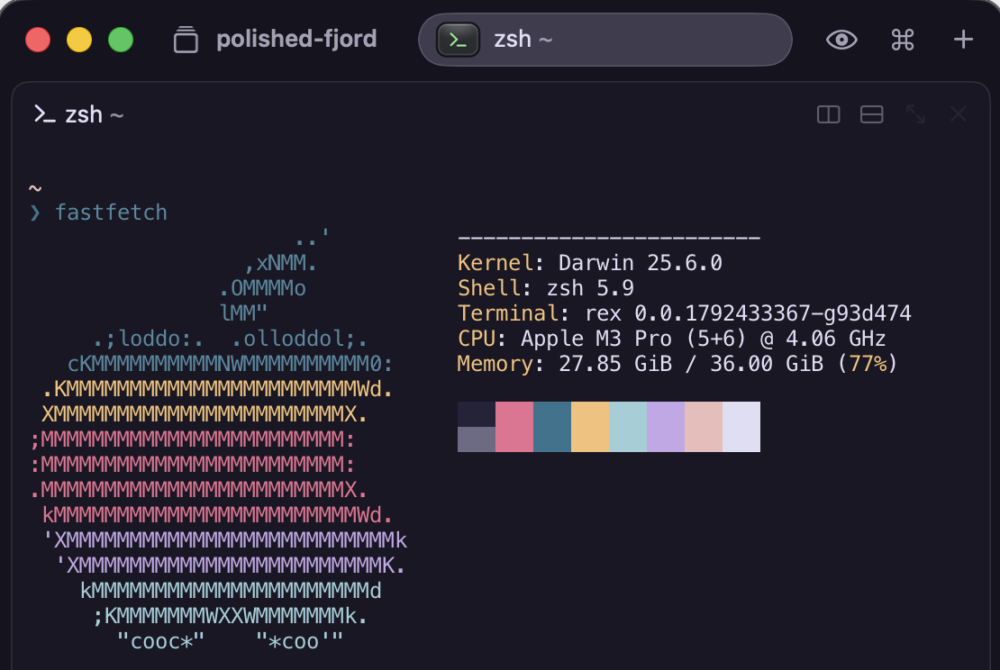
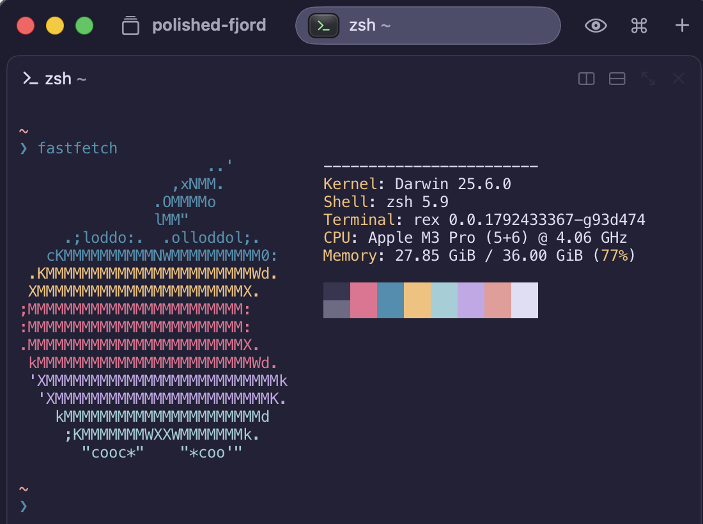
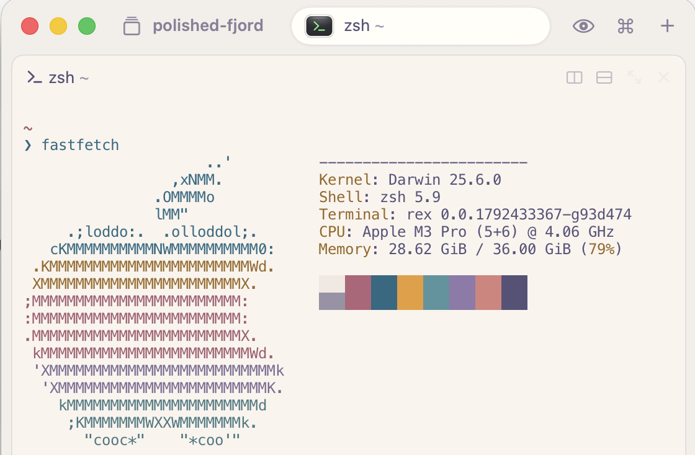

<p align="center">
    
    <h2 align="center">Rosé Pine for Rex</h2>
</p>

<p align="center">All natural pine, faux fur and a bit of soho vibes for the classy minimalist</p>

## Usage

1. Download a variant from [`dist`](./dist), or with curl:

   ```sh
   # Rosé Pine
   curl -fsSLO https://raw.githubusercontent.com/sergot/rose-pine-rex/main/dist/rose-pine

   # Rosé Pine Moon
   curl -fsSLO https://raw.githubusercontent.com/sergot/rose-pine-rex/main/dist/rose-pine-moon

   # Rosé Pine Dawn
   curl -fsSLO https://raw.githubusercontent.com/sergot/rose-pine-rex/main/dist/rose-pine-dawn
   ```

2. Open Rex
3. Under **Settings**, choose **Import Theme File** and pick the downloaded file. Rex imports the theme and selects it.

> Rex doesn't support setting the theme from `init.lua` yet. A terminal's
> colors follow the client that owns its block, so the app's theme setting is
> the one that sticks. If Rex adds a config-driven way to set it, it will be
> documented here.

## Gallery

### Rosé Pine



### Rosé Pine Moon



### Rosé Pine Dawn



## Thanks to

- [Filip Sergot](https://github.com/sergot)

## Contributing

<!-- BLOOM_BUILD_START -->
This theme was built using [bloom](https://github.com/rose-pine/rose-pine-bloom):

```sh
bloom build template --output dist --prefix $ --format hex
```
<!-- BLOOM_BUILD_END -->
